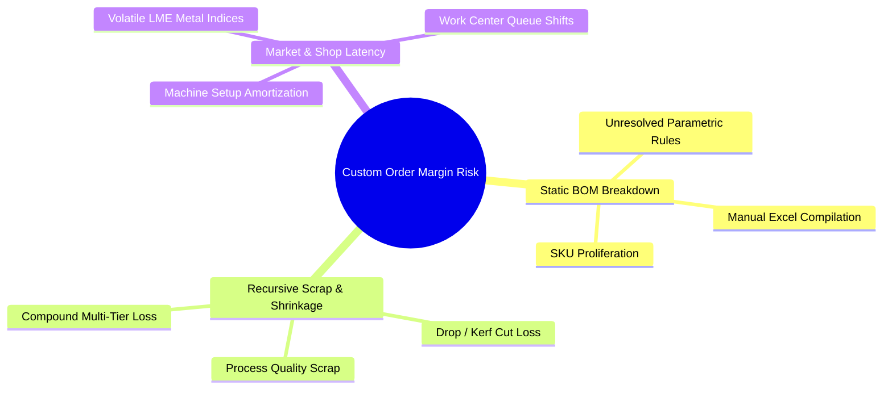
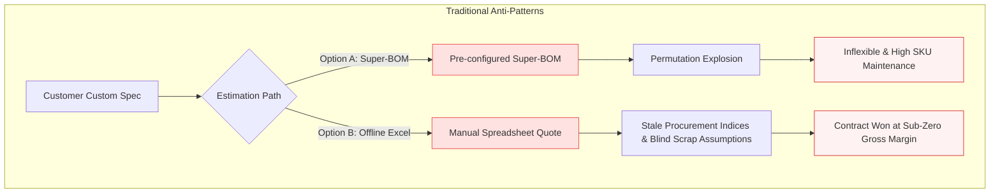
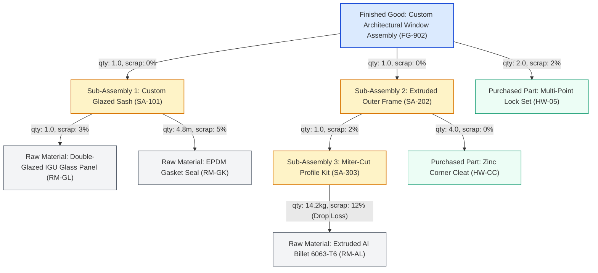
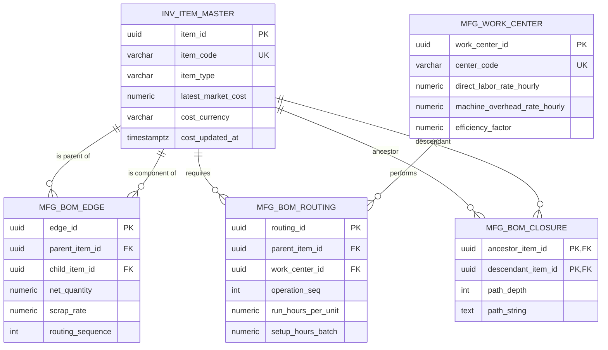
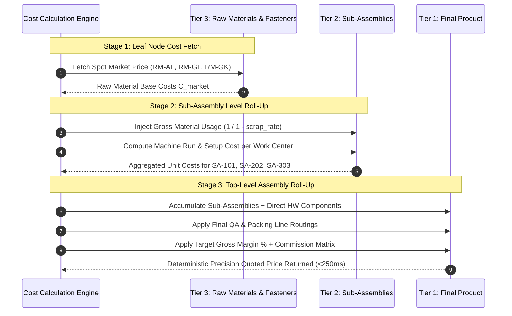
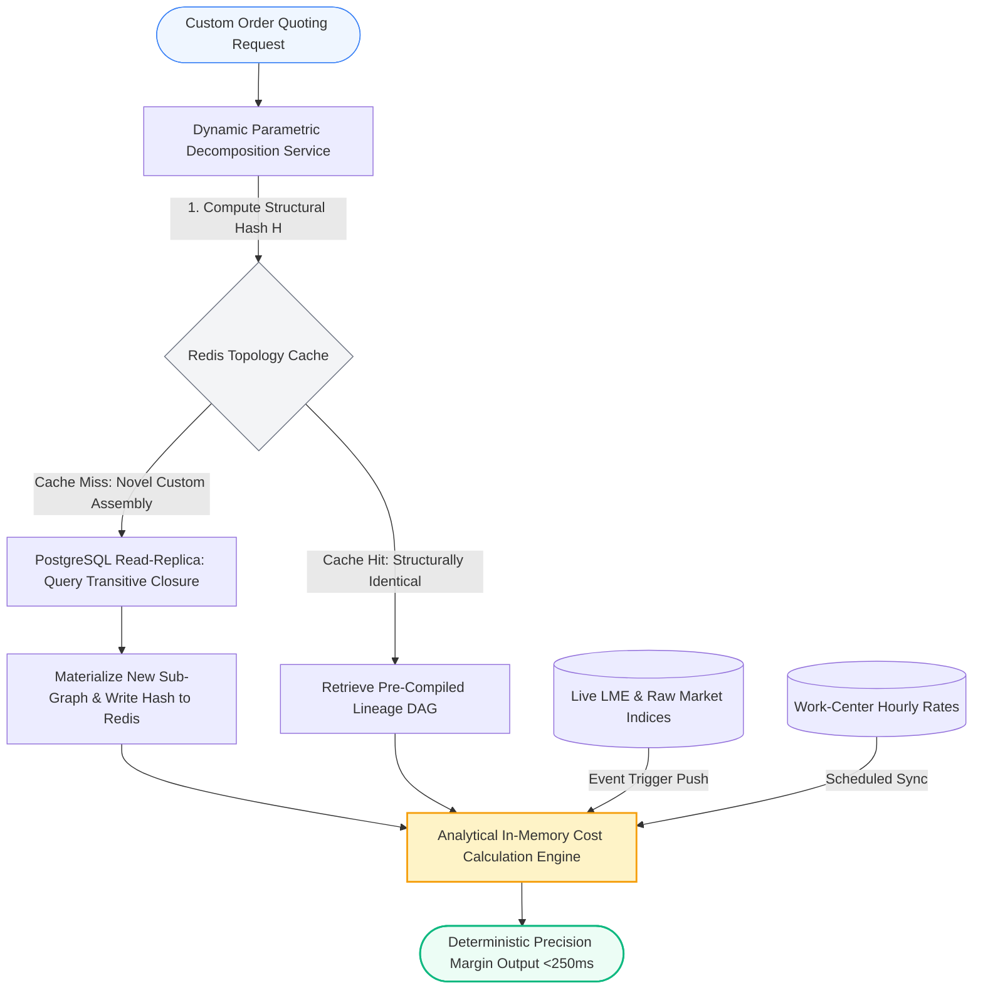
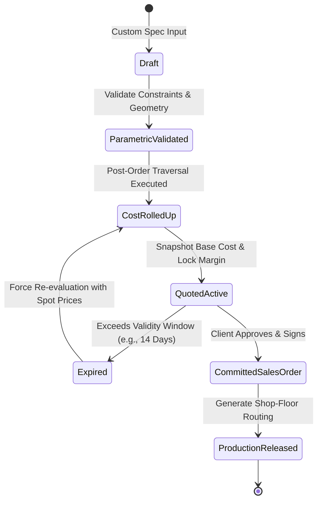

# Real Time Cost Rollup for Custom Manufacturing BOMs

**Author:** Ardiana Rangga

**Topic:** Enterprise Data Modeling, Production Systems Architecture & Supply Chain Engineering

**Context:** Independent Engineering & Systems Architecture Project (Inspired by Industry Experience in Precision Manufacturing)

---

Based on my work experience, a static bom from an excel file or spreadsheet usually erodes custom-made manufacturing projects.
Raw material prices often fluctuate up and down in the middle of processing an order.
A quotation can just become irrelevant so that once the goods are shipped, the expected margin of around 20% might not be achieved.

Relying on recursive queries directly on the active production data table will not survive at scale. This method directly locks production records.
So i think that there should be a solution. The solution is a Directed Acyclic Graph (DAG). The computer quietly calculates prices in real time so that if there are price changes, we can carry out a rescue mission much faster.

---

## Executive Summary

For high mix custom manufacturers, margin leakage already happens before the work comes in, so often the factory actually loses money due to miscalculation.
This happens because

1. The records are manual and rigid.
2. Forgot to count the wasted remaining resources
3. Late to know that material prices have already gone up



We organize the parts breakdown as a clean family tree without circular loops.
So instead of making an ordinary database that is slow, I propose mapping the relationships between components as a DAG so that the relationship between parts is clear, ordered, and not back-and-forth.

For the calculation method, we can use bottom-up post order. The system calculates the costs in order from the smallest first

With this method, the hope is that even if the component structure goes up to 8 levels down, the price can come out in an instant (under 0.25 seconds). ($<250\text{ ms}$ for $N \ge 8$ hierarchy depths).

---

## 1. The Engineering & Commercial Dilemma: Margin Leakage in Custom Order Lifecycles

Unlike Mass-Production Factories (Make-to-Stock), their BOM never changes because the production is always the same. While for Custom Order Goods (CTO & ETO) every time an order comes in, it has to be recalculated because its bom is definitely unique:

$$
\vec{P}_{\text{order}} = \{ \text{profile\\_gauge}, \text{alloy\\_grade}, \text{anodizing\\_microns}, \text{custom\\_length}, \text{hardware\\_matrix} \}
$$

Usually, traditional ERP does one of the two following:



### Manifestation of Margin Erosion

The Estimating Engineer / Estimating Staff team usually makes mistakes that cause losses.

1. Cost from offcuts or drop scrap
2. Machine or labor costs as fixed costs
3. Market prices change beforehand

---

## 2. Structural Topology & Relational Schema Modeling

The arrangement structure of goods (Bill of Materials) is actually similar to a one-way family pedigree tree (DAG).
- Where the node represents the raw material / mill finish / finished good
- The arrow indicates which part is assembled where, complete with the quantity of material required, so there must be no looping in the process

### 2.1 Graph Formulation & Visual Topology

THe BOM be defined as a directed graph $G = (V, E)$, where:

* $V = \{v_1, v_2, \dots, v_n\}$ (Collect all parts in storage, from raw materials, mill finish, to finished goods (finished goods are usually almost non-existent)).
* $E = \{(u, v) \in V \times V\}$ (Assembly directional pointers where smaller parts are mounted toward larger materials wherecomponent $v$ is a direct child required to construct parent $u$).
* Each edge $e = (u, v)$ carries an attribute vector $\mathbf{w}\_{uv} = \langle q\_{uv}, s\_{uv}, \text{scrap type} \rangle$, denoting required net quantity $q\_{uv}$ and expected scrap shrinkage factor $s\_{uv} \in [0, 1)$ or simply each connection is given an important note, such as how many units are needed, or what percentage is required depending on the leftover scrap offcuts.

A strict condition of physical assembly trees is acyclicity:

$$
\forall v_i \in V, \quad \nexists \text{ path } v_i \leadsto v_i \quad (\text{i.e., } G \text{ contains no directed cycles}).
$$

*lol thanks AI, help me formulating this complex things in my mind, next time the formulation I will generate by AI but I ensure the formula is represent my intention. also I hope you understand my mindmap :D

Below is a visual representation of a typical custom architectural assembly modeled as a DAG:



---

### 2.2 Relational Entity-Relationship Diagram (ERD)

With that, the hope is to be able to record or update new spare part data quickly. Aside from that, it is also expected to be able to read the genealogical sequence of the goods arrangement from top to bottom without worrying about the system freezing. it can be implemented like:



```sql
-- 1. Entity: Items / Materials / Assemblies Master
CREATE TABLE inv_item_master (
    item_id UUID PRIMARY KEY DEFAULT gen_random_uuid(),
    item_code VARCHAR(64) UNIQUE NOT NULL,
    description TEXT NOT NULL,
    item_type VARCHAR(16) NOT NULL CHECK (item_type IN ('RAW', 'PURCHASED', 'SUBASSEMBLY', 'FINISHED')),
    base_uom VARCHAR(16) NOT NULL,
    current_std_cost NUMERIC(18, 6) DEFAULT 0.000000,
    latest_market_cost NUMERIC(18, 6) DEFAULT 0.000000,
    cost_currency VARCHAR(3) DEFAULT 'IDR',
    cost_updated_at TIMESTAMPTZ NOT NULL DEFAULT CURRENT_TIMESTAMP,
    is_active BOOLEAN NOT NULL DEFAULT TRUE
);

-- 2. Hierarchical Edge Relation: BOM Billable Structures
CREATE TABLE mfg_bom_edge (
    edge_id UUID PRIMARY KEY DEFAULT gen_random_uuid(),
    parent_item_id UUID NOT NULL REFERENCES inv_item_master(item_id),
    child_item_id UUID NOT NULL REFERENCES inv_item_master(item_id),
    revision_version VARCHAR(16) NOT NULL DEFAULT '1.0',
    net_quantity NUMERIC(14, 6) NOT NULL CHECK (net_quantity > 0),
    scrap_rate NUMERIC(6, 4) NOT NULL DEFAULT 0.0000 CHECK (scrap_rate >= 0 AND scrap_rate < 1),
    routing_sequence INT DEFAULT 10,
    uom VARCHAR(16) NOT NULL,
    is_critical_path BOOLEAN DEFAULT FALSE,
    CONSTRAINT uq_bom_edge UNIQUE (parent_item_id, child_item_id, revision_version),
    CONSTRAINT chk_no_self_reference CHECK (parent_item_id <> child_item_id)
);

-- 3. Manufacturing Operations / Work-Center Route Association
CREATE TABLE mfg_work_center (
    work_center_id UUID PRIMARY KEY DEFAULT gen_random_uuid(),
    center_code VARCHAR(32) UNIQUE NOT NULL,
    name VARCHAR(128) NOT NULL,
    direct_labor_rate_hourly NUMERIC(14, 4) NOT NULL DEFAULT 0.0000,
    machine_overhead_rate_hourly NUMERIC(14, 4) NOT NULL DEFAULT 0.0000,
    setup_cost_fixed NUMERIC(14, 4) NOT NULL DEFAULT 0.0000,
    efficiency_factor NUMERIC(5, 4) NOT NULL DEFAULT 1.0000
);

CREATE TABLE mfg_bom_routing (
    routing_id UUID PRIMARY KEY DEFAULT gen_random_uuid(),
    parent_item_id UUID NOT NULL REFERENCES inv_item_master(item_id),
    work_center_id UUID NOT NULL REFERENCES mfg_work_center(work_center_id),
    operation_seq INT NOT NULL,
    run_hours_per_unit NUMERIC(10, 6) NOT NULL DEFAULT 0.000000,
    setup_hours_batch NUMERIC(10, 4) NOT NULL DEFAULT 0.0000,
    allocated_batch_size NUMERIC(12, 2) NOT NULL DEFAULT 1.00,
    CONSTRAINT uq_routing_step UNIQUE (parent_item_id, operation_seq)
);

-- 4. Transitive Closure / Path Index for Non-Recursive High-Velocity Reads
CREATE TABLE mfg_bom_closure (
    ancestor_item_id UUID NOT NULL REFERENCES inv_item_master(item_id),
    descendant_item_id UUID NOT NULL REFERENCES inv_item_master(item_id),
    path_depth INT NOT NULL,
    path_string TEXT NOT NULL,
    PRIMARY KEY (ancestor_item_id, descendant_item_id)
);
CREATE INDEX idx_bom_closure_descendant ON mfg_bom_closure(descendant_item_id);
```

---

## 3. The Dynamic Cost Roll-Up Algorithm

To know the true cost of a custom order, the computer can first calculate the smallest spare parts, add the processing costs, and sum them upward once the sub-assemblies are calculated.
AI, do your magic by creating the formula:

### 3.1 Mathematical Cost Formulation

For any node $u \in V$:

$$
\text{Unit Cost}(u) = \begin{cases} C_{\text{market}}(u), & \text{if } u \in \{\text{RAW}, \text{PURCHASED}\} \\ \sum_{v \in \text{Children}(u)} C_{\text{component}}(u, v) + \sum_{k \in \text{Routing}(u)} C_{\text{operation}}(u, k) + C_{\text{overhead}}(u), & \text{if } u \in \{\text{SUBASSEMBLY}, \text{FINISHED}\} \end{cases}
$$

Where the effective component cost accounts for scrap inflation:

$$
C_{\text{component}}(u, v) = \text{Unit Cost}(v) \times \left( \frac{q_{uv}}{1 - s_{uv}} \right)
$$

And operational routing cost at work center $k$ amortized over batch size $B_u$ is defined as:

$$
C_{\text{operation}}(u, k) = \left( t_{\text{run}}(u, k) + \frac{t_{\text{setup}}(u, k)}{B_u} \right) \times \frac{R_{\text{labor}}(k) + R_{\text{machine}}(k)}{\eta_k}
$$

Where:
* $t_{\text{run}}$: Operational machine/labor run time per unit.
* $t_{\text{setup}}$: Batch setup changeover hours.
* $B_u$: Production lot size or custom order volume.
* $R_{\text{labor}}, R_{\text{machine}}$: Hourly rates.
* $\eta_k$: Work-center empirical efficiency factor ($\eta \le 1.0$).

---

### 3.2 Bottom-Up Roll-Up Sequence

The system will calculate from the outermost leaf nodes (the smallest parts) before the results are summed up into larger groups.The goal is so the computer does not miss calculating if there is a small part that does not have a price yet (0 / null).



---

### 3.3 High-Performance Post-Order CTE Traversal

The problem is that if we force the database to look up the product genealogy using recursive queries, the database can get locked because the workload is heavy.
That is why to prevent it from stalling, we structure the calculation hierarchically from bottom to top.

```sql
WITH RECURSIVE bom_traversal AS (
    -- Anchor: Extract root / top-level item of the custom order
    SELECT 
        e.parent_item_id AS root_id,
        e.parent_item_id,
        e.child_item_id,
        e.net_quantity,
        e.scrap_rate,
        (e.net_quantity / (1.0 - e.scrap_rate)) AS gross_quantity,
        1 AS depth_level,
        ARRAY[e.parent_item_id] AS traversal_path
    FROM mfg_bom_edge e
    WHERE e.parent_item_id = :target_custom_item_id

    UNION ALL

    -- Recursive Step: Traverse downward along child dependencies
    SELECT 
        t.root_id,
        e.parent_item_id,
        e.child_item_id,
        e.net_quantity,
        e.scrap_rate,
        (t.gross_quantity * (e.net_quantity / (1.0 - e.scrap_rate))) AS gross_quantity,
        t.depth_level + 1 AS depth_level,
        t.traversal_path || e.parent_item_id
    FROM mfg_bom_edge e
    INNER JOIN bom_traversal t ON e.parent_item_id = t.child_item_id
    WHERE NOT e.child_item_id = ANY(t.traversal_path) -- Cycle containment assertion
)
SELECT 
    bt.depth_level,
    m.item_code,
    m.item_type,
    bt.gross_quantity,
    m.latest_market_cost,
    (bt.gross_quantity * m.latest_market_cost) AS extended_material_cost
FROM bom_traversal bt
JOIN inv_item_master m ON bt.child_item_id = m.item_id
ORDER BY bt.depth_level DESC;
```

---

## 4. Architectural Mitigation of Relational Query Bottlenecks

If a factory has hundreds of thousands of items, then structures them up to 8 levels down, this will stall. We can actually provide a quotation in less than a second. The requirement is that the calculation must be separated from the manufacturing daily work records so it does not become a burden.



### 1. Structural Hash Keying

So the computer does not need to recalculate the exact same product arrangement, we create a procedure with a unique code for each combined custom-order part.
The code is generated from a combination of the parts list, cut dimensions, and machine routing that can be reused.

$$
\mathcal{H} = \text{Hash}\left(\bigcup_{i=1}^{n} \{\text{item\\_id}_i, \text{qty}_i, \text{work\\_center}_i\}\right)
$$

If $\mathcal{H}$ exists in the cache, the structural traversal is bypassed entirely. The system takes the stored parts tree and updates it with the latest material prices.

### 2. Quotation State Transition Machine

To avoid a situation where we are about to close a deal and the total price suddenly changes on its own, the solution is that we need status rules (draft > quoted > approved).



---

## 5. Industrial Synthesis & Business Impact

If we calculate from the smallest parts, we can derive the business impact as shown in the following table:

| Evaluation Metric | Manual / Legacy Modality | Automated Algorithmic Engine |
| :--- | :--- | :--- |
| **Quoting Turnaround** | 2 to 4 business days | Real-time quoting ($<250\text{ ms}$) |
| **Scrap Factor Modeling** | Fixed, static scrap assumptions | Dynamic drop/kerf scrap factors |
| **Procurement Pricing** | Trailing average inventory costing | Real-time spot market index sync |
| **Margin Variance** | Estimated $3\%\text{--}7\%$ margin slippage | Margin precision within $\pm 0.2\%$ |

### 5.1 Elimination of Underpricing Hazards

Preparation for low volume custom product  manufacturing also needs to be calculated, as this usually takes more time.

$$
C_{\text{setup\\_unit}} = \frac{T_{\text{setup}}}{Q_{\text{order}}} \times R_{\text{rate}}
$$

So small-volume orders will be calculated using a different formula than mass-production orders.

### 5.2 Decoupled Estimation and Production Revisions

When a quotation is created, the system will take a snapshot of the part calculation running at that time, regardless of past prices or future prices.

---

## 6. Conclusion

Cost calculations in custom manufacturing are actually not a math problem, but a data structure organization problem in the database.

If we map the structure like a one-way DAG and calculate it in a dedicated engine, the hope is that the results will be more flexible and aligned with real costs on the ground.
